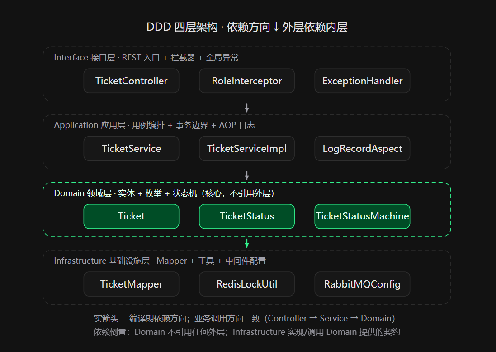
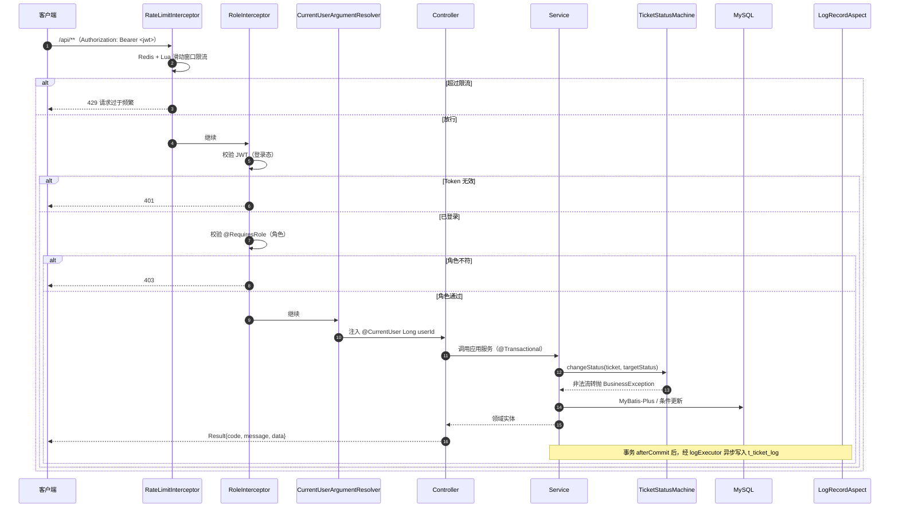
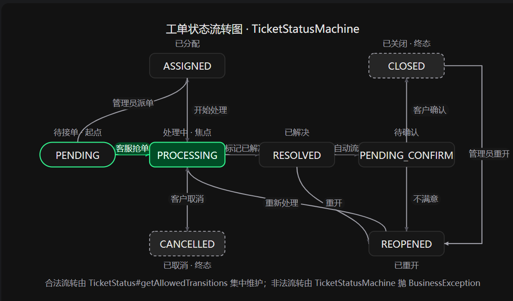
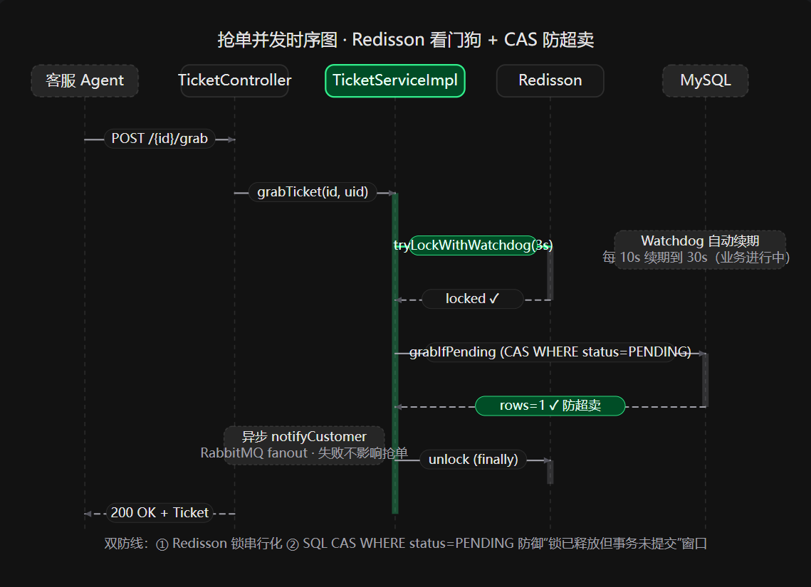
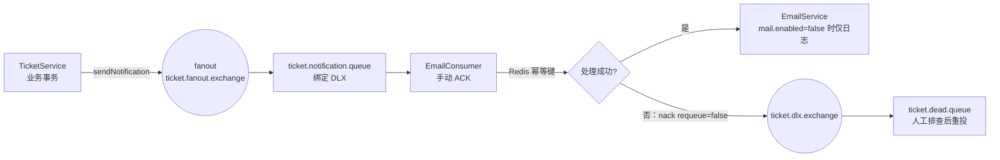
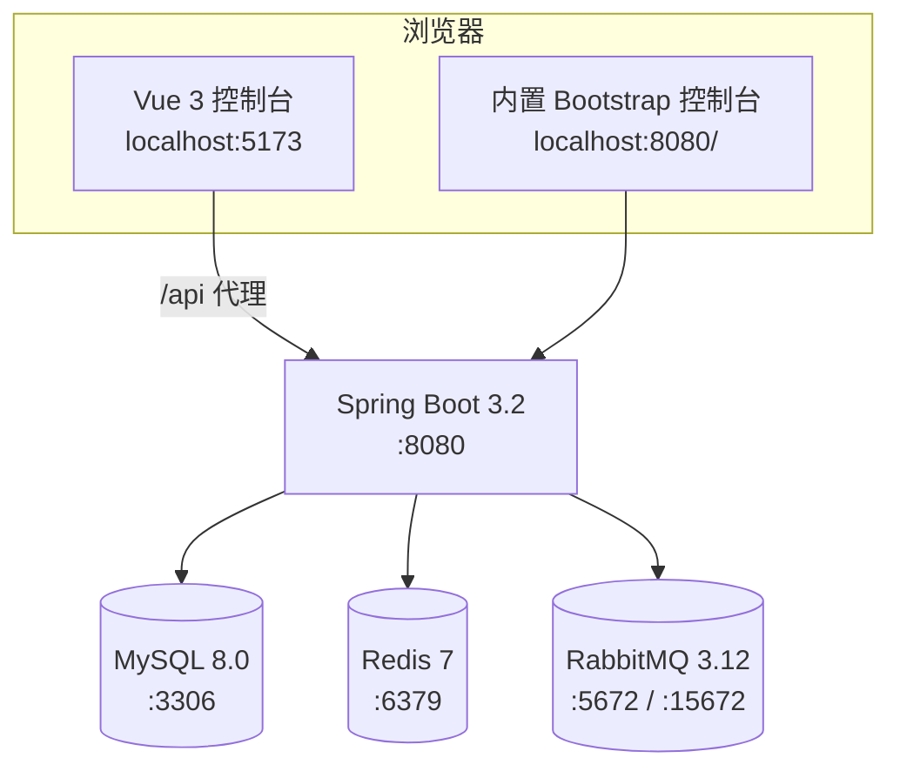

# TickeTide 工单管理系统

> 基于 Spring Boot 3.2 + MyBatis-Plus + Redisson + RabbitMQ 的轻量级企业工单管理系统

[](https://spring.io/projects/spring-boot)
[](https://www.oracle.com/java/)
[](https://vuejs.org/)
[](https://www.mysql.com/)
[](https://redis.io/)

---

## 📖 项目简介

TickeTide 是一个仿照企业 Support Desk 的轻量级工单系统，覆盖 **工单创建 → 派单/抢单 → 处理 → 解决 → 客户确认/驳回 → 满意度评价** 的完整闭环。

项目不追求功能大而全，重点展示一套可落地、可运行的后端工程实践：

- **分层设计**：以包边界落地 DDD 分层思想，把工单状态规则收敛到领域层。
- **状态机管控**：用一张集中维护的流转表替代散落各处的 `if-else`，非法状态变更统一拦截。
- **并发抢单**：Redisson 分布式锁 + 数据库条件更新 + 乐观锁，三层防线防止同一工单被重复抢走。
- **异步解耦**：RabbitMQ 通知链路、死信队列、消费幂等、手动 ACK，通知失败不影响主业务。
- **无侵入审计**：`@LogRecord` + AOP + SpEL 自动记录每一次状态变更，事务提交后异步落库。
- **服务端安全**：JWT 认证、角色鉴权、数据范围强校验、Redis 滑动窗口限流、敏感信息脱敏。

---

## ✨ 核心功能

| 模块 | 能力 |
| :--- | :--- |
| 用户与认证 | 注册、登录、当前用户信息、按角色查询用户；JWT 无状态认证 + BCrypt 密码哈希 |
| 工单流转 | 创建、分页查询、详情、编辑、删除；派单、抢单、接单、开始处理、解决、关闭、重开、取消、转交、升级 |
| 协作沟通 | 工单评论、附件上传/下载/删除（单文件 10MB） |
| 满意度 | 客户 1–5 星评价（每单仅一次），超时未确认自动关闭并默认好评 |
| 操作审计 | 工单时间线：操作人、动作、前后状态、备注，按工单/操作人分页查询 |
| 超时治理 | 待接单超时提醒管理员、待确认超时自动关闭，分布式锁保证多节点只执行一次 |
| 通知 | 状态变更邮件通知；未配置 SMTP 时降级为日志模拟，不阻塞主流程 |

---

## 🛠️ 技术栈

| 分类 | 技术 | 说明 |
| :--- | :--- | :--- |
| 语言 / 框架 | Java 17、Spring Boot 3.2.0 | Web、Validation、AOP、Mail、Scheduling |
| 持久层 | MyBatis-Plus 3.5.5、MySQL 8.0 | 单表 CRUD、分页插件、乐观锁插件、条件构造器 |
| 缓存 / 并发 | Redis 7、Redisson 3.23.5 | 分布式锁、滑动窗口限流、幂等标记、工单缓存 |
| 消息队列 | RabbitMQ 3.12（Spring AMQP） | 异步通知、手动 ACK、死信队列、消费幂等 |
| 认证 / 加密 | JJWT 0.12.6、Spring Security Crypto（BCrypt） | HMAC-SHA256 签名 Token、密码加盐哈希 |
| 对象映射 | Lombok、Jackson | 实体/JSON 序列化 |
| 前端（Vue） | Vue 3.5、Vite 6、Element Plus、Pinia、Vue Router、Axios | 独立开发端，`/api` 代理到后端 |
| 前端（内置） | Bootstrap 5（CDN）+ 原生 JavaScript | 后端静态资源内置控制台，零构建直接访问 |
| 部署 | Docker、Docker Compose | MySQL / Redis / RabbitMQ 一键启动 |

> 技术选型说明：项目刻意保持依赖精简——状态机使用枚举流转表而非 Spring StateMachine，DTO 转换使用静态工厂方法而非 MapStruct，认证使用 JJWT + 拦截器而非 Sa-Token，接口清单见本文档而非额外引入 API 文档组件。

---

## 🏗️ 系统架构设计

### 1. 架构风格与分层

项目是**单 Maven 模块的模块化单体**：四层以 `com.ticketide` 下的包边界体现，而不是物理多模块。这样保留了分层带来的依赖方向约束，同时让本地启动、调试和部署保持简单。



| 层次 | 代码位置 | 职责 | 代表类 |
| :--- | :--- | :--- | :--- |
| 接口层 | `controller`、`dto`、`annotation`、`interceptor`、`exception` | HTTP 入口、参数校验、认证鉴权、限流、统一响应与异常处理 | `TicketController`、`RoleInterceptor`、`RateLimitInterceptor`、`GlobalExceptionHandler` |
| 应用层 | `service`、`service.impl`、`aspect` | 用例编排、事务边界、跨领域协作、操作日志切面 | `TicketServiceImpl`、`UserServiceImpl`、`LogRecordAspect` |
| 领域层 | `entity`、`enums`、`state` | 工单实体、状态/优先级/分类枚举、合法流转表与状态机 | `Ticket`、`TicketStatus`、`TicketStatusMachine` |
| 基础设施层 | `mapper`、`config`、`consumer`、`task`、`util` | 持久化、Redis/RabbitMQ 配置、消息消费、定时任务、通用工具 | `TicketMapper`、`RabbitMQConfig`、`RedisLockUtil`、`TicketTimeoutScheduler` |

**边界说明（与教科书 DDD 的差异）**

- 没有独立的多模块工程，`domain` 也不是单独的 Maven 模块；分层以包依赖和职责划分约束。
- 实际调用方向为 `Controller → Service → Mapper / 领域对象`，领域规则（`enums`、`state`）不反向依赖接口层和应用层；这比“基础设施通过接口倒置”的严格 DDD 更简化，适合单体项目。
- 实体 `Ticket` 直接使用 MyBatis-Plus 注解（`@TableName`、`@Version`），属于轻量化取舍，并非完全框架无关的富领域模型。
- 没有引入领域事件总线：状态变更后的通知由应用服务显式调用 `RabbitMQService` 完成，保证调用链清晰、便于排查。
- 真正的领域约束集中在两处：`TicketStatus#getAllowedTransitions`（唯一流转表）与 `TicketStatusMachine#changeStatus`（校验并变更状态），Service 中不写状态判断。

### 2. 请求处理链路



链路中的关键设计：

1. **限流先行**：`RateLimitInterceptor` 的 `order=0`，先控制流量再做鉴权，避免恶意请求消耗鉴权成本。
2. **认证兜底**：`RoleInterceptor` 对 `/api/**` 统一校验 JWT，只有登录、注册在白名单内；身份只信任服务端签发的 Token，不读取可伪造的 `X-User-Id`。
3. **参数解析**：`CurrentUserArgumentResolver` 解析 `@CurrentUser`，Controller 不需要重复取 Header。
4. **权限分层**：接口级用 `@RequiresRole` 限制角色；数据级在 Service 内按 `CUSTOMER / AGENT / ADMIN` 强制过滤，前端隐藏按钮不作为安全边界。
5. **统一出口**：成功统一返回 `Result`；业务异常由 `BusinessException` 转 4xx，其余异常由 `GlobalExceptionHandler` 统一兜底，避免堆栈泄露。
6. **审计解耦**：`@LogRecord` 由 AOP 解析 SpEL，方法成功后先查新旧状态，再在事务提交后异步落库；业务代码零侵入。

### 3. 工单状态机



| 当前状态 | 允许流转到 | 触发动作 / 接口 |
| :--- | :--- | :--- |
| `PENDING` 待接单 | `ASSIGNED` / `PROCESSING` / `CANCELLED` | 管理员派单 `/assign`、客服抢单 `/grab`、客户取消 `/cancel` |
| `ASSIGNED` 已分配 | `PROCESSING` | 开始处理 `/start` |
| `PROCESSING` 处理中 | `RESOLVED` / `CANCELLED` | 标记解决 `/resolve`、客户取消 `/cancel` |
| `RESOLVED` 已解决 | `PENDING_CONFIRM` / `CLOSED` / `REOPENED` | 解决后自动进入待确认；兼容历史数据直接关闭/重开 |
| `PENDING_CONFIRM` 待确认 | `CLOSED` / `REOPENED` | 客户确认关闭 `/close`、驳回重开 `/reopen` |
| `REOPENED` 已重开 | `PROCESSING` | 重新处理 `/start` |
| `CLOSED` 已关闭 | `REOPENED` | 管理员重新打开 `/reopen` |
| `CANCELLED` 已取消 | — | 终态，不可再流转 |

实现要点：

- 流转表集中在 [TicketStatus.java](src/main/java/com/ticketide/enums/TicketStatus.java) 的 `getAllowedTransitions()`，新增状态只改这一处。
- [TicketStatusMachine.java](src/main/java/com/ticketide/state/TicketStatusMachine.java) 只做两件事：校验合法性、修改状态；不做持久化、不写日志，因此可在单元测试中脱离数据库验证。
- 非法流转统一抛 `BusinessException`，由全局异常处理器返回 400。
- 取消是独立用例，只能走 `/cancel`，防止通过通用状态接口绕过“仅创建人/管理员可取消”的权限校验。
- “解决”会连续流转 `PROCESSING → RESOLVED → PENDING_CONFIRM`，把客户确认环节显式建模，避免客服直接关闭工单。

### 4. 抢单并发控制



抢单是本项目并发风险最高的用例，采用三层防线：

1. **Redisson 分布式锁**：锁粒度为 `ticket:lock:{ticketId}`，等待 3 秒；使用看门狗模式（不显式指定租期），业务超过 30 秒时自动续期，避免“业务未提交、锁先过期”。
2. **数据库条件更新（CAS）**：`UPDATE ... WHERE id = ? AND status = 'PENDING' AND agent_id IS NULL AND version = ?`。即使锁已释放但事务尚未提交，数据库行锁仍能保证只有一个请求把状态改成功，影响行数为 0 即判定被抢走。
3. **乐观锁兜底**：实体 `version` 字段配合 MyBatis-Plus `OptimisticLockerInnerInterceptor`，防止其他更新路径发生丢失更新。

配套处理：

- 锁释放放在 `finally`，`unlock` 前校验 `isHeldByCurrentThread()`，避免误释放他人锁。
- 抢单接口叠加 `@RateLimit(limit = 3, window = 5, keyType = USER)`，抑制脚本刷单。
- 抢单成功后通过 MQ 通知客户；通知失败只记录日志，不回滚抢单结果。

### 5. 异步通知与消息队列



可靠性设计：

- **消息持久化 + 生产者确认**：`deliveryMode=PERSISTENT`，开启 `publisher-confirm-type=correlated`，未到达交换机时记录告警。
- **消费端手动 ACK**：处理成功才 `basicAck`；失败 `basicNack(requeue=false)` 进入死信队列，避免无限重试打爆消费者。
- **消费幂等**：以消息 `messageId`（缺失时退化到“工单 ID + 状态”）写入 Redis 作为幂等键，TTL 24 小时；失败时回滚幂等标记，保证死信重投仍能处理。
- **通知可降级**：`spring.rabbitmq.enabled=false` 时不装配 MQ 相关 Bean，服务层跳过通知并记录日志；邮件 `spring.mail.enabled=false` 时只打印模拟发送日志。
- **拓扑预留**：直连交换机还声明了 `ticket.create.queue`、`ticket.assign.queue`、`ticket.complete.queue` 及对应消费者，便于扩展更多异步场景；当前主链路使用 fanout 通知队列。

### 6. 定时任务与超时治理

`TicketTimeoutScheduler` 使用 `fixedDelay`（默认 10 分钟）扫描超时工单：

| 场景 | 判定条件 | 处理动作 |
| :--- | :--- | :--- |
| 待接单超时 | `status=PENDING` 且 `create_time <= now - 2h` | 邮件提醒全部管理员；Redis 幂等键保证同一工单 24 小时内只提醒一次 |
| 待确认超时 | `status=PENDING_CONFIRM` 且 `update_time <= now - 24h` | 自动关闭工单，并写入默认好评（幂等：`t_ticket_rating.ticket_id` 唯一索引兜底） |

多节点部署时，用 Redisson 业务锁 `ticket:schedule:timeout-scan`（租期 5 分钟）保证同一轮只有一个节点执行；单次扫描上限 200 条，避免一次拉取过多数据。参数可在 `application.yml` 的 `ticketide.*` 下调整。

### 7. 数据模型

| 表 | 说明 | 关键设计 |
| :--- | :--- | :--- |
| `t_user` | 用户 | `username`、`email` 唯一索引；`role` 取值 `ADMIN / AGENT / CUSTOMER`；密码 BCrypt 哈希 |
| `t_ticket` | 工单 | `status`、`priority`、`category`、`customer_id`、`agent_id`、`version`；状态/优先级/分类/客户/经办人均建索引 |
| `t_ticket_log` | 操作日志 | `ticket_id`、`operator_id`（可空表示系统操作）、`action`、`before_status`、`after_status`、`remark` |
| `t_ticket_comment` | 工单评论 | 按工单和创建时间索引，删除工单级联删除 |
| `t_ticket_rating` | 满意度评价 | `ticket_id` 唯一索引保证“一单一评”；记录评分、内容、被评价客服 |
| `t_ticket_attachment` | 附件 | 原始文件名、磁盘路径、大小、MIME、上传人；附件记录随工单删除级联清理（磁盘文件由业务删除接口处理） |

数据库初始化有两种方式：

- `init.sql`：供 Docker Compose 首次启动自动执行，包含建库、建表（4 张核心表）和演示数据。
- `schema.sql` + `DataInitializer`：应用启动时执行幂等迁移，补齐 `category`、`version`、附件表、评价表，并把 `t_ticket_log.operator_id` 改为可空；同时校验测试账号密码哈希，必要时重新生成。

### 8. 横切能力

| 能力 | 实现方式 |
| :--- | :--- |
| 认证 | JWT（HMAC-SHA256，24 小时），Token 放在 `Authorization: Bearer` |
| 角色鉴权 | `@RequiresRole` + `RoleInterceptor`，角色枚举 `UserRole` |
| 数据权限 | Service 层强制过滤：客户只看自己的；客服看待接单池 + 自己负责的（`scope=mine` 只看自己）；管理员不受限 |
| 接口限流 | `@RateLimit` + Redis ZSET + Lua 滑动窗口，支持 IP / USER / METHOD 三种维度 |
| 乐观锁 | `@Version` + `OptimisticLockerInnerInterceptor`，更新影响行数为 0 时抛业务异常 |
| 操作日志 | `@LogRecord` + AOP + SpEL；支持调用容器 Bean 生成备注；事务 `afterCommit` 后由 `logExecutor` 异步写入 |
| 异步线程池 | `attachmentExecutor`（附件）、`logExecutor`（日志）相互隔离，拒绝策略为 `CallerRunsPolicy`，避免丢任务 |
| 文件存储 | 本地磁盘 `uploads/yyyyMMdd/UUID.ext`，文件名去路径、大小与路径穿越校验 |
| 敏感脱敏 | `DataMaskUtil` 对手机号、邮箱打码，用于用户自由填写的评价内容等出参 |
| 健康检查 | `GET /health` 检查 MySQL、Redis、RabbitMQ（未启用时返回 `disabled`） |
| 统一响应 | `Result{code, message, data}`；业务异常 4xx，系统异常 5xx |

### 9. 部署拓扑



- 内置控制台由 Spring Boot 直接托管在 `src/main/resources/static`，无需 Node 环境即可使用完整功能（登录注册、工单池、详情、评论、附件、评价、派单/转交/升级等）。
- Vue 控制台是独立工程，开发期通过 Vite 代理 `/api` 到 8080，适合二次开发。

---

## 🚀 快速开始

### 方式一：Docker Compose 一键启动中间件（推荐）

```bash
docker compose up -d
```

启动内容与凭据（与 [application.yml](src/main/resources/application.yml) 保持一致）：

| 组件 | 端口 | 账号 / 密码 | 说明 |
| :--- | :--- | :--- | :--- |
| MySQL 8.0 | 3306 | `root` / `123456` | 自动创建 `ticketide` 库并执行 `init.sql` |
| Redis 7 | 6379 | 密码 `123456` | 分布式锁、限流、幂等、缓存 |
| RabbitMQ 3.12 | 5672 / 15672 | `ticketide` / `123456` | 管理界面 http://localhost:15672 |

启动后端：

```powershell
# Windows
.\mvnw.cmd spring-boot:run

# 或本机已安装 Maven
mvn spring-boot:run
```

启动前端（可选，用于 Vue 控制台）：

```bash
cd frontend
npm install
npm run dev
```

访问地址：

| 入口 | 地址 |
| :--- | :--- |
| 内置控制台（推荐直接体验） | http://localhost:8080/ |
| Vue 控制台 | http://localhost:5173/ |
| 健康检查 | http://localhost:8080/health |
| RabbitMQ 管理台 | http://localhost:15672/ |

> `start-app.ps1` 是作者本机的快捷启动脚本，其中 `JAVA_HOME` 与 Maven 路径为硬编码，使用前请按自己的环境修改。

### 方式二：本地手动启动

环境要求：JDK 17、Maven 3.8+、Node.js 18+、MySQL 8.0、Redis、RabbitMQ。

1. 初始化数据库（脚本会创建并使用 `ticketide` 库）：

   ```bash
   mysql -uroot -p < init.sql
   ```

2. 修改 [application.yml](src/main/resources/application.yml) 中的数据库、Redis、RabbitMQ 连接信息。

3. 启动后端：

   ```bash
   mvn spring-boot:run
   ```

4. 启动 Vue 前端（可选）：

   ```bash
   cd frontend
   npm install
   npm run dev
   ```

5. 浏览器访问 http://localhost:8080/ 或 http://localhost:5173/。

---

## ⚙️ 关键配置

配置文件：[src/main/resources/application.yml](src/main/resources/application.yml)

| 配置项 | 默认值 | 说明 |
| :--- | :--- | :--- |
| `server.port` | `8080` | 后端端口 |
| `spring.datasource.url` | `jdbc:mysql://localhost:3306/ticketide...` | 数据库连接，库名为 `ticketide` |
| `spring.data.redis.*` | `localhost:6379`，密码 `123456` | Redis 与 Redisson 配置需保持一致 |
| `spring.rabbitmq.enabled` | `true` | 设为 `false` 可关闭 MQ，通知自动降级为日志 |
| `spring.rabbitmq.listener.simple.acknowledge-mode` | `manual` | 消费端手动 ACK |
| `spring.mail.enabled` | `false` | 关闭时只打印模拟邮件日志 |
| `jwt.secret` / `jwt.expiration` | 内置密钥 / 24 小时 | **生产环境必须替换密钥** |
| `ticketide.upload-path` | `./uploads` | 附件存储根目录 |
| `ticketide.max-file-size` | `10485760` | 业务层单文件上限（10MB） |
| `ticketide.pending-timeout-hours` | `2` | 待接单超时提醒阈值 |
| `ticketide.confirm-timeout-hours` | `24` | 待确认超时自动关闭阈值 |
| `ticketide.timeout-scan-interval-ms` | `600000` | 超时扫描间隔（10 分钟） |

启用真实邮件：把 `spring.mail.enabled` 改为 `true`，并填写 `spring.mail.username` 与 SMTP 授权码（不是登录密码）。

---

## 📚 API 概览

所有业务接口以 `/api` 开头，响应结构统一为：

```json
{
  "code": 200,
  "message": "success",
  "data": {}
}
```

| 模块 | 方法与路径 | 角色 / 说明 |
| :--- | :--- | :--- |
| 认证 | `POST /api/users/login` | 公开；限流 10 次 / 60 秒 / IP |
| 认证 | `POST /api/users/register` | 公开；限流 3 次 / 60 秒 / IP |
| 用户 | `GET /api/users/me` | 当前登录用户 |
| 用户 | `GET /api/users`、`GET /api/users/role/{role}` | `ADMIN` |
| 用户 | `GET /api/users/{id}` | 登录用户 |
| 工单 | `POST /api/tickets` | `CUSTOMER`；限流 5 次 / 10 秒 / 用户 |
| 工单 | `GET /api/tickets` | 登录用户；按角色强制数据范围，支持状态/优先级/分类/关键词/时间/`scope=mine` |
| 工单 | `GET /api/tickets/{id}` | 登录用户；客户仅能查看自己的工单 |
| 工单 | `PUT /api/tickets/{id}/status` | 通用状态流转；取消必须走 `/cancel` |
| 工单 | `POST /api/tickets/{id}/assign` | `ADMIN` 派单 |
| 工单 | `POST /api/tickets/{id}/grab` | `AGENT` 抢单；限流 3 次 / 5 秒 / 用户 |
| 工单 | `POST /api/tickets/{id}/take` | `AGENT` / `ADMIN` 接单 |
| 工单 | `POST /api/tickets/{id}/start` | `AGENT` / `ADMIN` 开始处理 |
| 工单 | `POST /api/tickets/{id}/resolve` | `AGENT` / `ADMIN` 标记解决并进入待确认 |
| 工单 | `POST /api/tickets/{id}/close` | `CUSTOMER` / `ADMIN` 确认关闭 |
| 工单 | `POST /api/tickets/{id}/reopen` | `CUSTOMER` / `ADMIN` 驳回重开 |
| 工单 | `POST /api/tickets/{id}/cancel` | `CUSTOMER` / `ADMIN` 取消 |
| 工单 | `POST /api/tickets/{id}/transfer` | `AGENT` / `ADMIN` 转交 |
| 工单 | `POST /api/tickets/{id}/escalate` | `AGENT` / `ADMIN` 升级为高优先级 |
| 工单 | `DELETE /api/tickets/{id}` | `ADMIN` |
| 评论 | `POST /api/comments?ticketId=` | 客户仅能评论自己的工单，客服仅能评论自己负责的工单，管理员不受限 |
| 评论 | `GET /api/comments?ticketId=`、`DELETE /api/comments/{id}` | 查询需工单访问权限；删除仅评论人本人或 `ADMIN` |
| 评价 | `POST /api/tickets/{id}/rating` | `CUSTOMER`；每单一次，评分 1–5 |
| 附件 | `POST/GET /api/tickets/{ticketId}/attachments` | 登录且有工单访问权限；上传限流 10 次 / 60 秒 / 用户 |
| 附件 | `GET /api/tickets/{ticketId}/attachments/{attachmentId}/download` | 登录且有工单访问权限 |
| 附件 | `DELETE /api/tickets/{ticketId}/attachments/{attachmentId}` | 上传人本人或 `ADMIN` |
| 日志 | `GET /api/logs/ticket/{ticketId}`、`GET /api/logs/operator/{operatorId}` | 分页查询操作日志 |
| 健康检查 | `GET /health` | 无需登录；返回 MySQL / Redis / RabbitMQ 状态 |

---

## 👤 测试账号

密码统一为 `123456`，数据库中存储 BCrypt 哈希。`DataInitializer` 启动时会校验并修复密码哈希。

| 角色 | 用户名 | 密码 | 说明 |
| :--- | :--- | :--- | :--- |
| 管理员 | `admin` | `123456` | 派单、查看全部工单、转交/升级、重新打开、删除 |
| 客服 | `agent01` | `123456` | 抢单/接单、处理、解决、转交、升级 |
| 客服 | `agent02` | `123456` | 同上 |
| 客户 | `customer01` | `123456` | 创建工单、查看自己的工单、取消、确认关闭/驳回、评价 |
| 客户 | `customer02` | `123456` | 同上 |

---

## 🧪 测试

```bash
mvn test
```

测试均为 Mockito 纯单元测试，不依赖 MySQL / Redis / RabbitMQ，可直接运行。覆盖范围：

| 测试类 | 关注点 |
| :--- | :--- |
| `TicketStatusMachineTest` | 合法流转、非法流转、终态约束 |
| `TicketLifecycleTest` | 创建 → 抢单 → 解决 → 关闭/驳回的生命周期编排 |
| `ConcurrentGrabTicketTest` | 并发抢单、异常时锁释放 |
| `TicketServiceImplTest` | 工单服务核心分支与权限校验 |
| `RateLimitInterceptorTest` | 滑动窗口限流、维度 key 构建 |
| `EmailConsumerTest` | 正常消费、死信、幂等 |
| `GlobalExceptionHandlerTest` | 参数校验、业务异常、系统异常 |
| `CommentServiceImplTest` | 评论创建、删除权限 |
| `RatingServiceImplTest` | 一单一评、评分校验 |
| `UserServiceImplTest` | 登录、注册、密码校验 |

---

## 📁 项目结构

```text
DDD/
├── pom.xml                        # 单模块 Maven 工程
├── docker-compose.yml             # MySQL / Redis / RabbitMQ
├── init.sql                       # 建库建表 + 演示数据
├── start-app.ps1                  # 本机启动脚本（路径需按环境修改）
├── docs/images/                   # 架构图、状态图、时序图
├── frontend/                      # Vue 3 + Vite + Element Plus 控制台
│   └── src/
│       ├── api/                   # Axios 封装与接口定义
│       ├── layouts/               # 基础布局
│       ├── router/                # 路由与登录守卫
│       ├── stores/                # Pinia 用户状态
│       ├── utils/                 # 字典、格式化、防抖
│       └── views/                 # 登录、工单池、工单详情
├── uploads/                       # 附件存储目录（运行时生成）
└── src/
    ├── main/java/com/ticketide/
    │   ├── TickeTideApplication.java
    │   ├── annotation/            # @CurrentUser、@LogRecord、@RateLimit、@RequiresRole
    │   ├── aspect/                # 操作日志切面与 SpEL 备注辅助
    │   ├── config/                # MyBatis-Plus、Redis、RabbitMQ、WebMvc、异步、初始化
    │   ├── consumer/              # 通知/创建/指派/完成消息消费者
    │   ├── controller/            # 用户、工单、评论、评价、附件、日志、健康检查
    │   ├── dto/                   # request / response / message
    │   ├── entity/                # User、Ticket、OperatorLog、Comment、Rating、Attachment
    │   ├── enums/                 # 状态、优先级、分类、角色
    │   ├── exception/             # BusinessException、GlobalExceptionHandler
    │   ├── interceptor/           # 限流、登录与角色鉴权
    │   ├── mapper/                # MyBatis-Plus Mapper
    │   ├── service/               # 服务接口与实现
    │   ├── state/                 # TicketStatusMachine
    │   ├── task/                  # 超时扫描定时任务
    │   └── util/                  # JWT、Redis 锁、脱敏、当前用户上下文
    ├── main/resources/
    │   ├── application.yml        # 主配置
    │   ├── bootstrap.yml          # 应用名
    │   ├── schema.sql             # 完整建表脚本
    │   └── static/                # 内置 Bootstrap 控制台
    └── test/java/com/ticketide/   # 单元测试
```

---

## 📝 设计说明与已知限制

- **单模块单体**：适合轻量团队和二次开发；若要拆分微服务，可按 `controller / service / domain / infrastructure` 边界演进。
- **状态机为自研轻量实现**：通过枚举流转表 + 单一组件控制，未引入 Spring StateMachine；复杂审批流（并行分支、子状态）需要扩展表结构。
- **JWT 无刷新与黑名单**：登出仅前端丢弃 Token，Token 在 24 小时内仍然有效；生产环境建议缩短有效期并引入刷新令牌/黑名单。
- **附件为本地磁盘存储**：多实例部署需要共享存储或改为对象存储；下载接口未做病毒扫描。
- **数据库演进**：当前用 `init.sql` + `DataInitializer` 做幂等迁移，未引入 Flyway / Liquibase；生产环境建议纳入版本化迁移工具。
- **MQ 为可选依赖**：关闭后通知降级为日志，业务主流程不受影响；直连交换机的部分队列为扩展预留，当前主链路以 fanout 通知为准。
- **两个前端并存**：内置 Bootstrap 控制台功能更完整；Vue 控制台当前覆盖登录、工单池、详情与状态流转，可按需继续扩展。
- **安全配置**：部署前务必替换 `jwt.secret`、数据库/Redis/RabbitMQ 默认密码，并按最小权限创建数据库账号。
